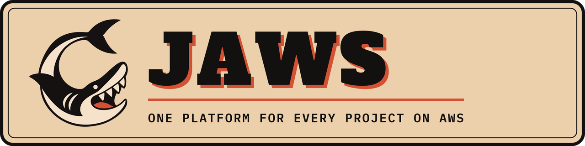

[](https://github.com/Jaws-Platform)

# jaws-branding

[](https://github.com/Jaws-Platform/jaws-branding/releases/latest)
[](https://github.com/Jaws-Platform/jaws-branding/actions/workflows/ci.yml)
[](https://github.com/Jaws-Platform/jaws-branding/blob/main/LICENSE)

The Jaws brand in one place: the coiled shark logo, the avatars for the
organization and its GitHub Apps, the banner every Jaws README opens with,
and the standard for README headers. It is part of
[Jaws](https://github.com/Jaws-Platform/jaws). Other repositories link to the
files here instead of copying them, so a change to the brand reaches every
one of them without a pull request.

## Assets

Every path below is **published**: other repositories link to it on `main`,
so it is never moved, renamed or removed. What is drawn at a path can change
freely.

| Asset | Path | Size | Used for |
|---|---|---|---|
| Logo | [`assets/logo/jaws-logo.png`](assets/logo/jaws-logo.png) | 1024 × 1024, transparent | Anywhere that supplies its own background |
| Avatar | [`assets/avatar/jaws-avatar.png`](assets/avatar/jaws-avatar.png) | 1024 × 1024, paper background | The `Jaws-Platform` organization picture, and the logos of `jaws-platform-release-bot` and `jaws-platform-comments` |
| README banner | [`assets/banner/jaws-readme-banner.png`](assets/banner/jaws-readme-banner.png) | 1280 × 320 | The first line of every Jaws README, and the organization profile |

The raw URL of any asset is
`https://raw.githubusercontent.com/Jaws-Platform/jaws-branding/main/<path>`.

The avatar keeps the shark inside the circle GitHub crops avatars to, on a
paper tone a shade darker than the shark's belly so the belly stays visible.
When a GitHub App asks for a badge background color, use the paper color
`#ECCFAB`.

## README headers

Every Jaws repository's README opens with the same three parts, in this
order:

1. **The shared banner**, linked to the organization. Link to it; never copy
   it into the repository, or a change to the brand will not reach it.
2. **The repository's name** as the only level-one heading.
3. **The repository's own badges**, one per line in a single paragraph. Which
   badges a repository shows is its own choice. Use
   [shields.io](https://shields.io) badges in the default flat style, or the
   GitHub Actions badge for CI, and put them in this order where they apply:
   package or registry version, release, CI, license, then anything else the
   repository adds.

Then one paragraph that says what the repository is, linking to
[Jaws](https://github.com/Jaws-Platform/jaws).

Copy this block and replace `<repo>` and the badges:

```markdown
[](https://github.com/Jaws-Platform)

# <repo>

[](https://github.com/Jaws-Platform/<repo>/releases/latest)
[](https://github.com/Jaws-Platform/<repo>/actions/workflows/ci.yml)
[](https://github.com/Jaws-Platform/<repo>/blob/main/LICENSE)

What this repository is, in one paragraph. It is part of [Jaws](https://github.com/Jaws-Platform/jaws).
```

A Terraform module repository puts its registry badge first:

```markdown
[](https://registry.terraform.io/modules/Jaws-Platform/<name>/aws/latest)
```

The banner and badges use Markdown image syntax with absolute URLs, not HTML
or relative paths, because the Terraform Registry renders these READMEs too
and supports neither.

## Palette and type

The colors are sampled from the logo.

| Name | Hex | Use |
|---|---|---|
| Ink | `#131010` | The shark's body and outline, the wordmark, text |
| Cream | `#F7E2CA` | The shark's belly and teeth |
| Paper | `#ECCFAB` | Backgrounds behind the logo: the banner card and the avatar |
| Red | `#D45133` | The shark's mouth; the wordmark's shadow and the banner's rule |

The wordmark is set in [Alfa Slab One](https://fonts.google.com/specimen/Alfa+Slab+One)
and the tagline in [IBM Plex Mono](https://fonts.google.com/specimen/IBM+Plex+Mono)
SemiBold. Both are in `fonts/` under the SIL Open Font License, which is next
to each font file.

## Changing the brand

Every asset is drawn by [`scripts/render.py`](scripts/render.py) from the
original logo in `source/` and the fonts in `fonts/`. To change one, edit the
script and render again:

```sh
uv run scripts/render.py           # writes every asset
scripts/check.sh                   # the same checks as CI
```

CI fails when a published path is missing or has the wrong size, and when a
committed asset no longer matches what the script draws. A redrawn asset is
a `feat`; moving or removing a published path is a breaking change (`feat!`)
and needs every repository that links to it updated first.

Contribution rules are in [CONTRIBUTING.md](CONTRIBUTING.md); the rules for
coding agents are in [AGENTS.md](AGENTS.md).
